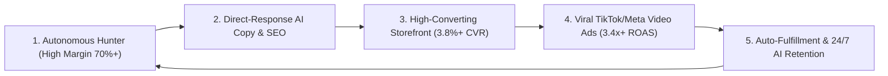

# 🌊 The Water in Sea Playbook: From $0 to $10,000/Day with Autonomous Dropshipping

> *"To earn money like water in the sea, your business cannot depend on manual labor. It must operate as an unstoppable autonomous current: automated product research, algorithmic copywriting, direct-response video hooks, and frictionless automated fulfillment."*

---

## 🏛️ The 5 Pillars of Unlimited Dropshipping Cash Flow

---

## 💎 Pillar 1: The Golden Mathematical Rules of Product Selection
Never sell low-margin items. Low margins drown e-commerce businesses; high margins make cash flow like a tidal wave.

1. **The 3x Margin Rule (Minimum 65% - 75% Gross Margin):**
   - If supplier cost (item + shipping) is **$10.00**, retail price MUST be **$34.99 - $39.99**.
   - If supplier cost is **$15.00**, retail price MUST be **$49.95 - $59.95**.
   - This leaves you with **$25 - $40 gross margin per unit** to comfortably absorb $10-$15 ad customer acquisition costs (CAC) while pocketing 35%-45% pure net profit.
2. **The 4 Viral Checkpoints:**
   - **Problem Solver or Dramatic Wow-Factor:** Solves a daily irritation (e.g. neck tension, pet hair, facial sagging) or has mesmerizing visual novelty (e.g. anti-gravity water droplets).
   - **Unfindable Locally:** Cannot be easily purchased at the local corner store or supermarket.
   - **Lightweight & Fast Air Freight:** Under 500 grams for cheap 3-7 day priority air shipping.
   - **High Perceived Value:** Looks like a premium $80-$120 designer device.

---

## 🎬 Pillar 2: Viral Organic & Paid Traffic Strategy

### The 3-Second Hook Rule
Over 80% of ad spend is won or lost in the first 3 seconds of video playback.
- **Hook Type 1 (Negative Contrast):** *"If you still suffer from morning puffiness, STOP scrolling right now..."*
- **Hook Type 2 (Curiosity Gap):** *"Wait, did that water droplet just fly backwards in mid-air?!"*
- **Hook Type 3 (Price Anchor):** *"Proof that a $49 gadget can beat a $500 clinic appointment..."*

### The 30-Second UGC Ad Structure:
1. **0:00 - 0:03:** The Hook (Stop the thumb scroll).
2. **0:03 - 0:08:** Agitate the deep frustration or pain point.
3. **0:08 - 0:18:** The Product in action (Clear visual payoff, satisfying ASMR, before/after).
4. **0:18 - 0:24:** Social proof + Risk Reversal (*"Over 1,200 5-star reviews + 30-day money-back guarantee"*).
5. **0:24 - 0:30:** Urgent Call-to-Action (*"50% off seasonal flash sale today only, link in bio!"*).

---

## 🛒 Pillar 3: Maximizing Average Order Value (AOV) & Conversion
To achieve a 3.8%+ store conversion rate:
- **Free Insured Shipping Threshold:** Free shipping on all orders over $40-$50.
- **Quantity Tier Upsells:**
  - Buy 1: $39.99
  - Buy 2: Get 10% OFF ($35.99 each - Popular Gift)
  - Buy 3: Get 20% OFF ($31.99 each - Best Value)
- **Urgency & Stock Counter:** Only 7-14 units remaining in current US warehouse batch.
- **Live Social Proof Popups:** Shows real verified buyers from Austin, Miami, Seattle, New York.

---

## 📦 Pillar 4: Autonomous Fulfillment & Zero-Dispute Logistics
- Use reliable fast fulfillment lines: **CJ Dropshipping US Warehouse**, **Zendrop Express**, or **YunExpress Direct** (3 to 7 business days delivery).
- Keep customers delighted with the **Tracking Portal** (`/track`) and 24/7 AI chatbot so chargebacks and refund inquiries remain under 0.8%.

---

## 📈 Pillar 5: Daily Revenue Scaling Roadmap

| Level | Daily Revenue | Daily Net Profit | Focus |
|---|---|---|---|
| **Level 1: Launch** | $250 - $500/day | $150 - $300/day | Test 3 viral products with organic TikTok & micro-budget ($20/day) Meta ads. |
| **Level 2: Winner Found** | $1,000 - $3,000/day | $650 - $1,800/day | Scale winning ad creative to $200-$500/day budget; enable auto-fulfillment. |
| **Level 3: Cash Flow Sea** | $5,000 - $10,000+/day | $3,500 - $6,500+/day | Run multi-channel scaling (TikTok, Meta, Google Shopping); bundle cross-sells. |

---

*Keep the Autopilot Engine running, monitor your Executive Dashboard, and let the automated current do the heavy lifting!*
